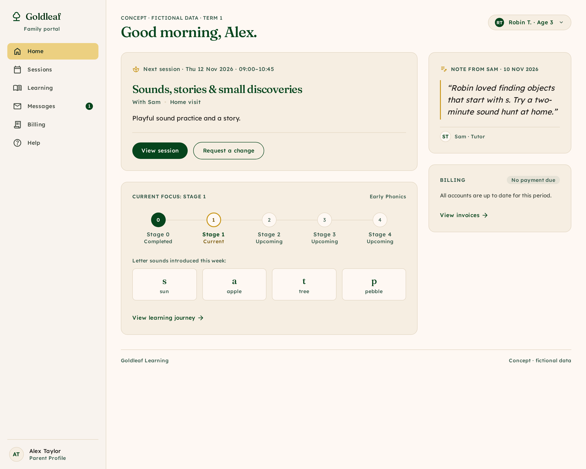
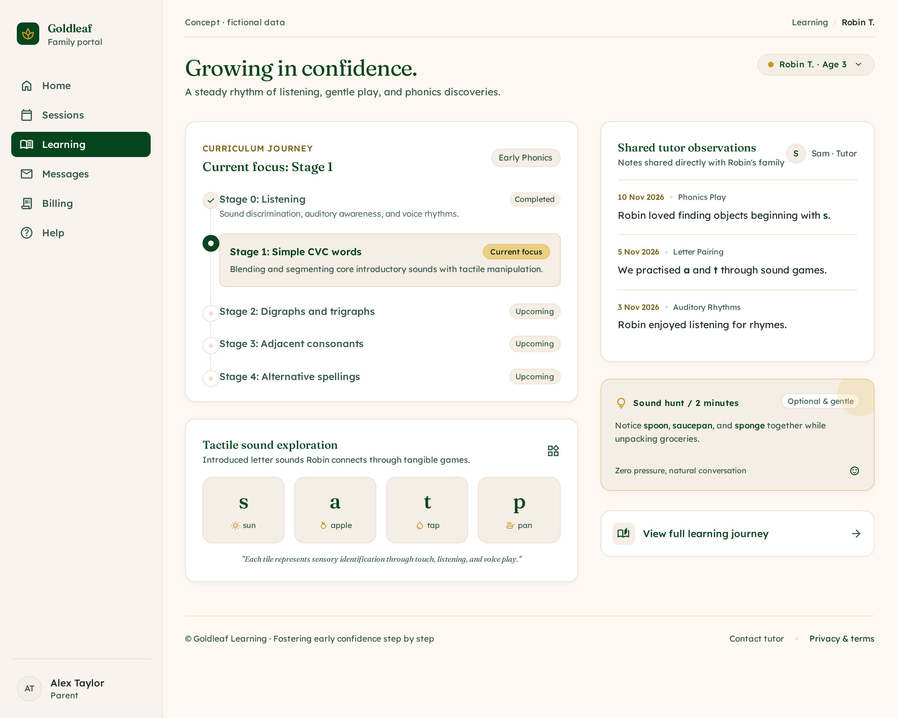
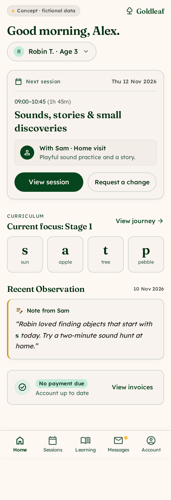
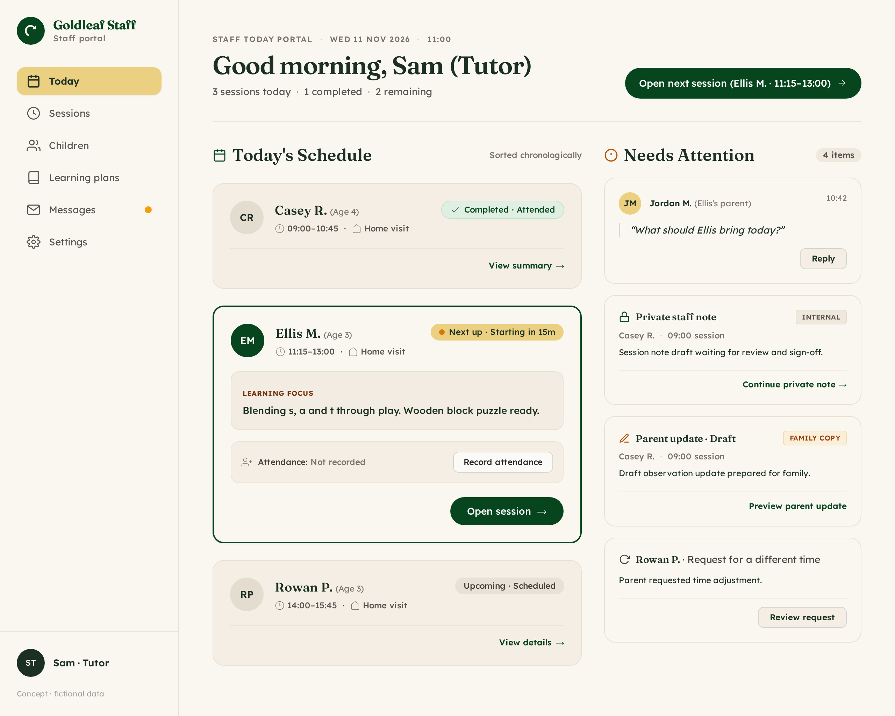
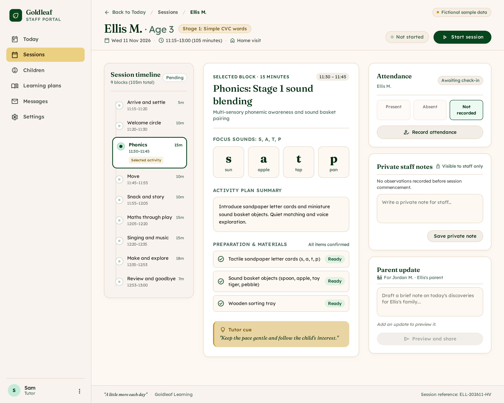
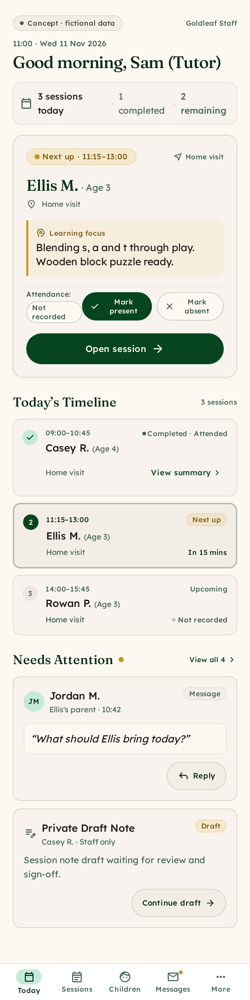

# Staff and parent portal mockups

Six reviewed Stitch concepts, archived on 11 November 2026. These are design references with fictional data, not implemented portal features.

> **Historical session plan:** these screenshots show 105-minute sessions from checkout `26b96ba`. Current main uses **120-minute sessions**. Use [current session content](../../content/session.ts) and [business facts](../../content/site.ts) when implementing the portal; do not copy the old timing or infer billing rules from these images.

[Design brief and references](DESIGN-BRIEF.md) · [Editable Stitch project](https://stitch.withgoogle.com/projects/8457214603129819597) (account access required)

## Parents

| Home, desktop | Learning journey, desktop | Home, mobile |
| --- | --- | --- |
|  |  |  |

## Staff

| Today, desktop | Session workspace, desktop | Today, mobile |
| --- | --- | --- |
|  |  |  |

## Archive and implementation boundaries

- PNG files are the original exported previews, preserved without resizing or editing. The brief records each Stitch screen ID and reference sources.
- Parent priorities: sessions, learning observations, messages and billing. Staff priorities: attendance, planning and parent communication.
- Private staff notes and parent updates are separate concepts. Actual access control, invitations, delivery, payments and error states still need implementation and testing.
- Use the repository's actual wordmark, Fraunces/Lexend typography and shared design tokens. Incidental generated glyphs and the stale global Stitch theme are not a new design system.
- The screenshots were reviewed visually; they do not establish keyboard, screen-reader or authorisation compliance.

Feature map: [PORTAL-CONCEPTS and PORTAL](../../FEATURE_TREE.md#portal-design-reference). Graph nodes: `portal_concepts` and `portal_planned` in [graph.json](../../graphify-out/graph.json).
